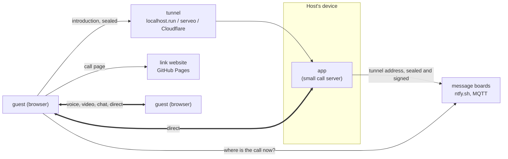

# p2p-call

Group calls with no servers of your own: voice, video, screen sharing, music and chat go straight between the participants (WebRTC mesh). The call is hosted on the host's phone or computer; friends join by a link from any browser and install nothing.

## What it does

- Calls for several people (up to 10), everyone connected directly to everyone else.
- Camera and screen sharing at the same time, with screen audio (Chrome, Edge).
- Play a song from a file on your own device to everyone, as a live stereo stream. The file is never uploaded anywhere.
- Chat: messages travel between open pages and are stored nowhere. Once everyone has left, the chat is gone.
- The host can remove a participant, close the door to newcomers, ask someone to mute, and end the call for everyone.
- Several ways to invite people: a permanent link (the same every time), a one-time call (the link dies after the call), a direct link to the tunnel (no website, no message boards), and a call with no app at all.
- Every participant is a tile: showing their camera, or the first letter of their name. A dot on the tile shows how the connection to them is doing (audio loss, delay); long-press for details.
- The connection looks after itself: a drop is noticed within seconds and repaired through other participants; if two people can't hear each other directly, a third one relays the voice between them; every audio packet carries copies of the previous ones (RED), so a lost packet goes unheard.

## How to use it

**The easiest way needs no install.** Open the project page, press "Start call" and send the link to your friends:
<https://p2p-call.github.io/p2p-call/>

**With the app** the call is more reliable (there is someone to let latecomers in and fix connections), and the link is permanent. Downloads are on the [latest release](https://github.com/p2p-call/p2p-call/releases/latest) page:

| System | File |
|---|---|
| Android (8 or newer) | `p2p-call-android.apk` |
| Windows | `p2p-call-windows-x64.exe` |
| Mac with M1 or newer | `p2p-call-mac-apple-silicon.zip` |
| Mac with Intel | `p2p-call-mac-intel.zip` |
| Linux | `p2p-call-linux-x64.tar.gz`, `p2p-call-linux-arm64.tar.gz` |

On a computer, the app opens its own page in your browser: "Start call" (how exactly is chosen in the line under the button and remembered) or "Join a call". It has no window of its own; it quits by itself once the page is closed. There is no app for iPhone — join from the browser.

The apps are not signed, so the system will warn you on first launch; the release notes explain how to get past the warning.

## How it works



1. The host starts the app. It runs a small server on the host's device and a free tunnel to it.
2. The tunnel address is random and changes often, so people get a permanent link to the project page instead: `https://…/#name.secret`. The app posts the current tunnel address to public message boards, sealed and signed.
3. A guest opens the link. The page finds the address on a board, connects through the tunnel to the host's app and learns who is in the call.
4. From then on the browsers connect to each other directly (WebRTC). Audio, video and chat never pass through the host's server; it only introduces people.

There is also a call **with no app**: it is created right on the web page, participants find each other through the same message boards, and the host's rights are signed orders that the pages verify themselves.

And there is the **direct link** to the tunnel, for those who can't or won't depend on GitHub and the boards: a link like `https://tunnel-address/#r=name&k=secret`, where the call page is served by the host's app itself. The only outside service left is the tunnel (plus the public STUN servers, which every option uses). The cost: the address changes whenever the tunnel reconnects (the host's page shows the new link right away and tells everyone already in the call the new address itself; it also has "Check" to see whether the address is alive and "Reconnect tunnel"), and the page comes through someone else's tunnel, which in theory could tamper with it; the guest's browser shows a warning about this. The Android app opens such a link with its own built-in page, so there is nothing to tamper with.

**Tunnels.** The app sets up a free tunnel with no sign-up by itself: localhost.run first, then serveo.net if that fails (it shows guests its own "Continue to Site" warning once in the browser), and on a computer also Cloudflare. You can pick the tunnel yourself, on the app's start page and in the Android app ("Tunnel"). If you're willing to sign up somewhere (ngrok, Tailscale Funnel, your own Cloudflare tunnel) and get a fixed address, point it at the app's port and pass the address to the app: `p2p-call -tunnel https://my-address`.

**Connection resilience.** Browsers learn their internet address from several public STUN servers run by different owners (Google, Cloudflare, Twilio, Nextcloud); any one that's alive is enough. Pages tell each other "I'm here" every second, so a lost connection is noticed within 3–4 seconds. Repair (a new handshake) goes not only through the app or the board but also through any participant connected to both sides, signed so they can't tamper with it. If two people can't hear each other directly (a drop, a bad connection, or they never got through at all), a third participant relays one's voice to the other by mixing it into their own; once the direct connection is good again, everything goes back. Video isn't relayed this way; it's too heavy.

### Who sees what

| Who | Sees | Doesn't see |
|---|---|---|
| Message boards (ntfy.sh, MQTT servers) | that someone at some address posted something, and how much | whose call it is, the tunnel address, names: all sealed with a key from the link |
| Tunnel | incoming addresses and traffic volume | names, handshakes, commands: the connection between the page and the app is sealed (ECDH + AES-GCM) and vouched for by the host's key. With a direct link the tunnel also serves the page itself, which protects against someone watching but not against someone swapping the page |
| GitHub Pages | that the page was opened | the full link: the browser never sends anything after `#` to the server |
| Participants | each other's internet addresses (that's how direct connections work) | — |

The call name in the link is the fingerprint of the host's key, so nobody along the way can impersonate the host's app. The secret in the link is never sent anywhere; it derives the place on the board, the key to the posted address, and the password the guest gives the app when joining. Neither the board nor the tunnel can build the link.

### What it doesn't do

- This is not a professional audit. The encryption was reviewed in-house.
- Whoever serves the page (GitHub) also serves its code. If you don't trust that, host your own; see below.
- Everyone-to-everyone means every pair has to get through. On mobile internet that doesn't always work: then a third participant relays the voice between those two (not video). If only two people are in the call and they can't reach each other, there's no call: there is deliberately no relay server (TURN), because the app must work without any sign-ups.
- In a call with no app, removing a participant is a polite request: they still have the link. The real protection is a new link.
- If the host's device goes to sleep, newcomers can't get in; those already connected keep talking.
- ntfy.sh has a limit of 250 messages a day per internet address. An ordinary call needs far fewer; spare boards are there in case it refuses.

## Host your own

Everything tied to a specific place is in one file, [`call/web/site.json`](call/web/site.json):

```json
{
  "site": "https://NAME.github.io/p2p-call/",
  "repo": "NAME/p2p-call",
  "board": "https://ntfy.sh",
  "spare": ["wss://test.mosquitto.org:8081/", "wss://broker.hivemq.com:8884/mqtt"],
  "app": "io.github.NAME.p2pcall",
  "stun": ["stun:stun.l.google.com:19302", "stun:stun.cloudflare.com:3478", "…"]
}
```

1. Fork the repo, edit `site.json`, run `sh scripts/sync-page.sh` (it copies the call page into `docs/c1/`) and commit.
2. In the repository settings, turn on GitHub Pages from the `/docs` folder of the `main` branch. That's the link website.
3. For links to open straight in the Android app, the site root (`https://NAME.github.io/.well-known/assetlinks.json`, which is a separate `NAME.github.io` repository) must hold a file with the APK signing key fingerprint. Everything works without it; links just open in the browser.
4. The APK signing key goes in the repository secrets: `KEYSTORE_B64` (PKCS12 in base64, alias `p2pcall`) and `KEYSTORE_PASS`. Without them the APK is signed with a throwaway key and won't install as an update over the previous one.
5. Releasing: `git tag v1.0.0 && git push origin v1.0.0`; GitHub Actions builds the apps and publishes the release.

It's best to keep the site under its own name (a separate GitHub account or organization): to the browser, all pages of one `NAME.github.io` are a single site, so another project under the same name would get access to call keys and to the microphone permission.

You can run your own board too: `board` is any server that speaks the [ntfy](https://ntfy.sh) protocol, and `spare` lists MQTT servers reachable over WebSocket that keep the last message.

## From source

You need Go (the version is in `go.mod`).

```sh
go run .                 # the app's page in the browser: start a call or join one
go run . -now            # start a call with a tunnel right away
go run . -now -direct    # the same, but with a direct link to the tunnel, no website or boards
go run . -tunnel none    # a call on this computer only
go run . -h              # all flags
go test ./...
```

What's where:

| Path | What |
|---|---|
| `main.go`, `start.html`, `update.go` | the desktop app and its start page |
| `call/` | the call itself: server and room (`call.go`, `room.go`), sealed connection (`wire.go`), key and link (`identity.go`), boards (`relay.go`, `spare.go`), tunnels (`lhr.go` for localhost.run and serveo, `tunnel.go` for Cloudflare) |
| `call/web/` | the call page: `app.js` (startup and joining), `link.js` (connection to the app), `meet.js` (call with no app), `peers.js` (connections, audio), `bridge.js` (drops, repair through others, voice via a third participant), `music.js`, `chat.js`, `video.js`, `ui.js` |
| `docs/` | the link website: `index.html` and a copy of the call page in `c1/` |
| `mobile/`, `android/` | the Android app: the same server inside (`gomobile`), a screen with a WebView |
| `scripts/try/` | headless browser scenarios: joining by link, direct link, call with no app, audio, drops and voice via a third participant, the desktop app's start page (`start.cjs`; run it with `P2P_NO_OPEN=1` so the app doesn't open a browser itself) |
| `scripts/testboard/` | a local message board for testing, so the real one's limit isn't spent |

The Android app is built only in GitHub Actions (`.github/workflows/release.yml`).

Run the scenarios like this (needs Playwright with Chromium):

```sh
go build -o /tmp/p2p-call . && go build -o /tmp/testboard ./scripts/testboard
P2P_BIN=/tmp/p2p-call BOARD_BIN=/tmp/testboard node scripts/try/link.cjs
```

## License

[MIT](LICENSE).
